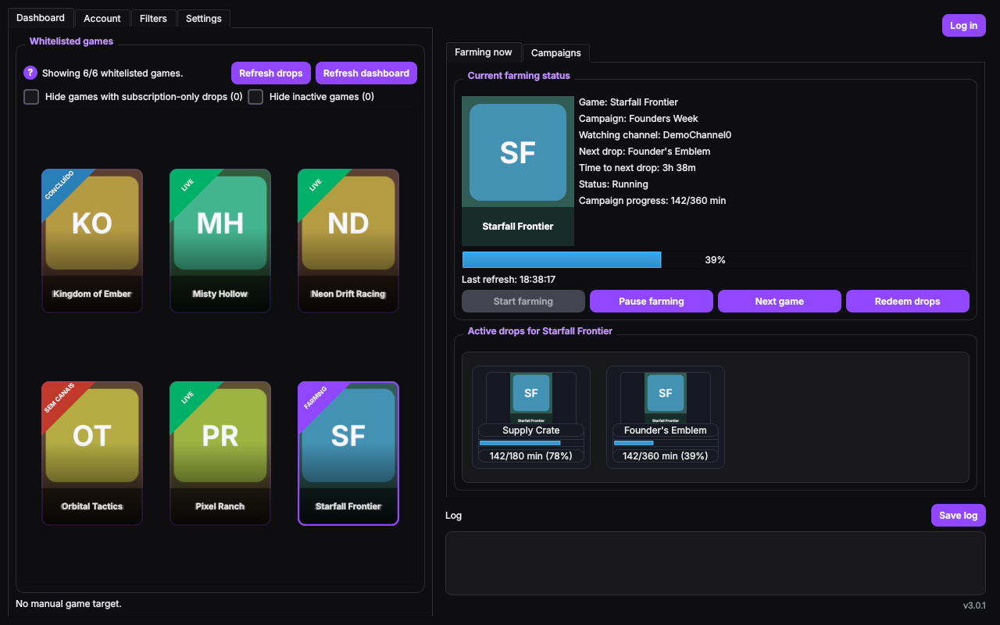
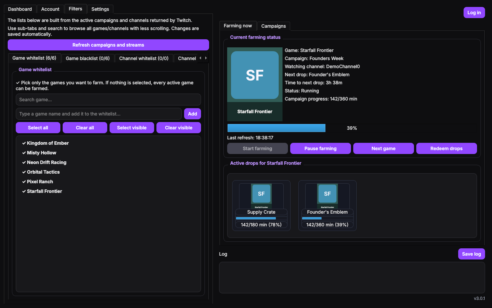
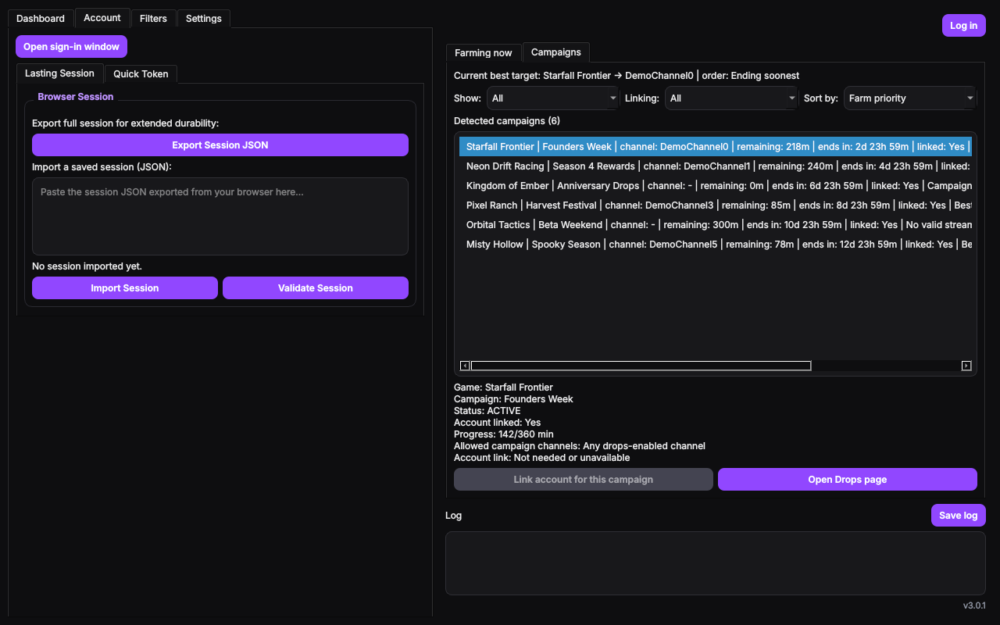
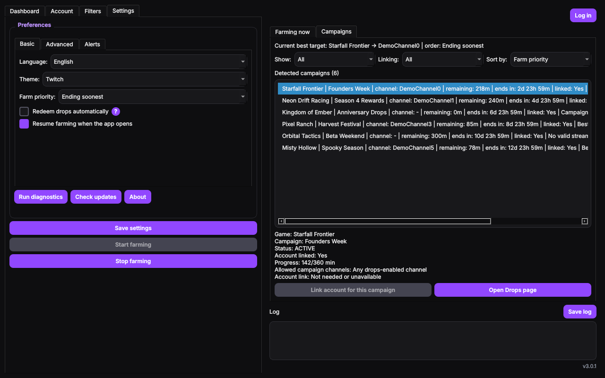
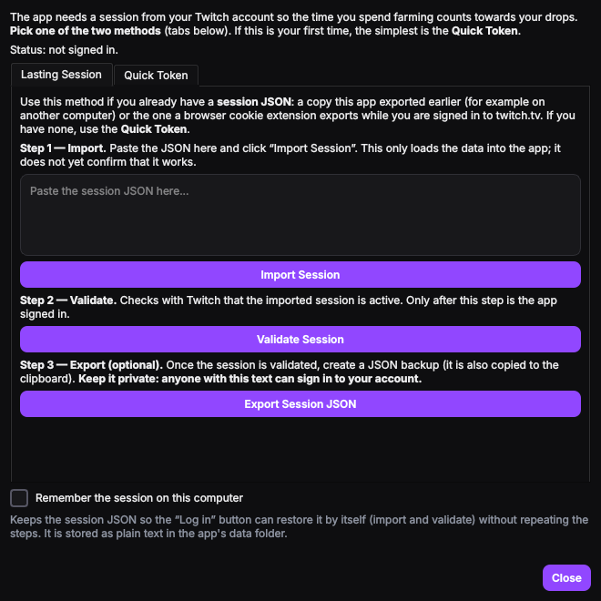
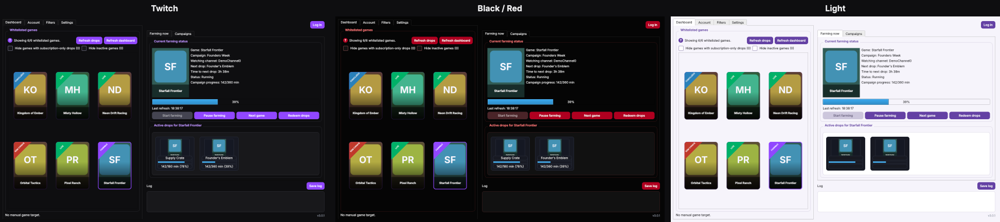

# Twitch Drop Farmer

[PT-PT](README.md) | [EN](README.en.md)

A desktop app (Python + PySide6) that farms **Twitch Drops** for you: it picks the campaign, keeps your watch
time counting without opening any video, recovers by itself when something stalls, and tells you when a drop
is ready to claim. Everything runs on your own computer.

> **Independent project, not affiliated with Twitch.** Automating viewing may go against the platform's terms of
> service, and Twitch can change or block what this app relies on at any time. Use it at your own risk. More in
> [Known limitations](#known-limitations) and [Disclaimer](#disclaimer).



*The screenshots use demo data (made-up games and channels), never a real account.*

## What it does

- **Finds campaigns**, active and upcoming. When Twitch refuses the dashboard ("failed integrity check"), it uses
  the public [twitchdrops.app](https://twitchdrops.app) registry to know what exists and keeps farming.
- **Picks the best target** by campaign rules, eligibility and available channel (configurable priority, such as
  "ending soonest"). You can **pin a game** from a dashboard card.
- **Farms without opening a video**: it sends the watch heartbeats and follows the channel's stream in the
  background, with few requests and energy profiles (Economic, Balanced, Aggressive).
- **Recovers by itself**: a monitor spots campaigns that are not crediting, restarts, switches channel and, as a
  last resort, gives up and sets the campaign aside. It remembers the campaigns you already finished so it does
  not farm them again.
- **Picks up where it left off**: it remembers the last game and, if the farm was running when you closed the app,
  starts again by itself (can be turned off).
- **Dashboard** with one card per game and a status ribbon: `FARMING`, `LIVE`, `A VERIFICAR` (checking),
  `SEM CANAIS` (no channels), `LIGAR CONTA` (link account), `SUBSCRIÇÃO` (subscription), `CONCLUÍDO` (done),
  `INATIVO` (inactive). Filters to hide subscription-only or inactive games.
- **Filters**: whitelist and blacklist for games and channels, with search and bulk actions.
- **Alerts** (and Windows notifications) for a drop ready to claim, a campaign about to expire, a farm without
  progress, a channel that went offline, an invalid session and connection errors.
- **Easy sign-in**: the **Log in** button explains each step; optionally it remembers the session on this computer.
- **Diagnostics and log**: a system diagnostic, and "Save log" writes a file with tokens and cookies **removed**,
  ready to share.
- Interface in **English** and **Portuguese (Portugal)**, with several themes.

## How it works

1. It reads your *Inventory* and the Twitch dashboard with your session to know your real progress.
2. It picks a channel with active drops for the game and sends the watch heartbeats, without playing video.
3. It checks in the *Inventory* that the minutes are really being credited. If not, it escalates: restarts the
   connection, switches channel, and finally moves on to the next campaign.

A game that has just started is not in the *Inventory* until Twitch has credited its first minutes (normally 2 to
3 minutes). Until then "Active drops" says it is **waiting** for the information, and only after 15 minutes
without data does it say "No active drops".

## Screenshots

*Demo data: made-up games, channels and drops, no real account. The dashboard is at the top of this page.*

### Farming now, with the filters

The live state of the farm (game, campaign, channel, progress and time to the next drop), the active drops and,
on the left, the game and channel lists.



### Campaigns and account

Every campaign found, with the state of each one, and the **Account** tab with the sign-in alternatives.



### Settings

Language, theme, farm priority, "Redeem drops automatically" (off by default, with the "?" explaining why) and
resuming the farm when the app opens.



### Log in

The window that explains each step, with two methods (session JSON or quick token) and the option to remember
the session on this computer.



### Themes

Three themes: Twitch, Black / Red and Light.



*The status ribbons on the cards (`CONCLUÍDO`, `SEM CANAIS`...) keep their Portuguese names in every language;
the "?" above the dashboard explains each one in English.*

## Installation

### Windows package (simplest)

You need 64-bit Windows 10 or 11. Python and Visual C++ do not have to be installed: they come in the package.

1. Go to [Releases](../../releases) and download `TwitchDropFarmer-win64.zip` (about 220 MB).
2. Extract the whole folder (not just the `.exe`) somewhere ordinary such as `Documents`, and open
   `TwitchDropFarmer.exe`.

The package is not signed, so Windows SmartScreen may warn you the first time ("More info" then "Run anyway"), and
some antivirus programs may distrust programs packaged with PyInstaller. If Windows says "VCRUNTIME140.dll is
missing" or similar, you extracted only the `.exe`: extract the whole folder.

### From source

You need Python 3.10 or newer (from [python.org](https://www.python.org); avoid the Anaconda one).

Windows (PowerShell):

```powershell
python -m venv .venv
.\.venv\Scripts\Activate.ps1
python -m pip install -r requirements.txt
$env:PYTHONPATH="src"
python -m twitch_drop_farmer
```

Linux / macOS:

```bash
python -m venv .venv
source .venv/bin/activate
python -m pip install -r requirements.txt
PYTHONPATH=src python -m twitch_drop_farmer
```

On Windows you can also double-click `TwitchDropFarmer.pyw`, which opens the app without a console window.
Windows is the main target; other systems should work (PySide6) but are not tested the same way.

## Getting started

1. Click **Log in** (top-right corner) and follow the steps. If you tick "Remember the session on this computer",
   next time the button signs in by itself.
2. In **Filters**, tick the games you want to farm (if you tick none, every active game can be farmed).
3. In **Dashboard**, click a card to pin a game, or let the app choose.
4. Click **Start farm**. Progress, channel and time to the next drop appear under "Farming now".
5. When the "Drop ready" notice appears, claim it at
   [twitch.tv/drops/inventory](https://www.twitch.tv/drops/inventory).

### Other ways to sign in (Account tab)

- **Quick token**: paste only the value of your browser's `auth-token` cookie (no cookie name, no `OAuth`
  prefix), save and validate.
- **Durable session**: export the session as JSON from the browser where you are signed in and import it in the
  Account tab.

## Redeeming drops

**"Redeem drops automatically" is off by default**, for a reason: Twitch usually rejects claims made by this
app ("failed integrity check"), while the same click on the website or on your phone works. Turning it on mostly
produces failed attempts (each one a burst of requests that Twitch may see as automation). The most reliable
choice is to claim at [twitch.tv/drops/inventory](https://www.twitch.tv/drops/inventory) when the app tells you.
The "?" next to the option explains this inside the app. The **Redeem drops** button makes one manual attempt.

## Your data and privacy

Everything stays on your computer, in the `~/.twitch-drop-farmer` folder (on Windows,
`C:\Users\<user>\.twitch-drop-farmer`):

| File | What it holds |
| --- | --- |
| `config.json` | Your settings and game/channel lists |
| `cookies.json` | The session cookie, **in plain text** |
| `session.json` | The kept session, **only if you say yes** to "Remember the session" (deleted when turned off) |
| `campaign_cache.json`, `registry_rewards.json`, `completed_campaigns.json` | Campaign caches (no secrets) |
| `logs/` | The logs you save, with secrets removed |

The app only talks to: Twitch (`twitch.tv` and its video and image servers), the public `twitchdrops.app`
registry (read only), `api.github.com` (to check for a new version) and, to get game covers Twitch does not
provide, DuckDuckGo, Google and Steam (with the **game name** only). There is no telemetry, no accounts of its
own and no project servers.

**Never share** `cookies.json`, `session.json` or a session JSON: whoever has them can sign in to your Twitch
account. Before opening an issue, review the log ("Save log" already removes tokens and cookies). Security policy
and responsible disclosure: [SECURITY.md](SECURITY.md).

## Known limitations

- Twitch may reject this app's requests with "failed integrity check". That is why automatic claiming is off by
  default and why some games have no per-drop detail for the first few minutes.
- **Subscription** drops cannot be farmed: they show the `SUBSCRIÇÃO` ribbon (and you can hide them).
- A new game takes a few minutes to show information (see [How it works](#how-it-works)).
- **Check for updates** only tells you whether a newer version exists; it does not download or install it.
- This relies on Twitch behaviour that changes without notice: if something stops working, the GraphQL queries
  may need updating.

## Troubleshooting

- `QtCore` DLL error on Windows: create the `.venv` with the official Python (python.org), not Anaconda's. If you
  use Conda, install `PySide6` from `conda-forge`. If it persists, reinstall the Microsoft Visual C++
  Redistributable and recreate the `.venv`.
- The app icon is still out of date on Windows: run `tools\refresh_icon_cache.ps1` (or, non-interactively,
  `powershell -ExecutionPolicy Bypass -File .\tools\refresh_icon_cache.ps1 -Force`).
- A campaign is not crediting: wait a few minutes (see [How it works](#how-it-works)). If it stays that way, the
  monitor switches channel and finally sets it aside. "Update dashboard" makes the app try again the ones it gave
  up on.
- You need to ask for help: use **Save log**, which creates a file with secrets removed, and attach it.

## Development

Tests (the interface runs without a screen with `QT_QPA_PLATFORM=offscreen`):

```bash
QT_QPA_PLATFORM=offscreen python -m unittest discover -s tests
```

The tests include a check that no file tracked by git has e-mails, tokens, account ids or user paths. To make it
look for terms of your own too (your username, for example), put them, one per line, in `tests/.private_terms`
(ignored by git).

Every change bumps the version in `src/twitch_drop_farmer/__init__.py` and adds an entry to the
[CHANGELOG](CHANGELOG.md); a test fails if either is missing.

Build the Windows package (it uses `onedir`, because a single `.exe` with Qt WebEngine would be huge):

```powershell
.\build_exe.ps1
```

It creates `dist\TwitchDropFarmer\TwitchDropFarmer.exe` and `dist\TwitchDropFarmer-win64.zip`. A `v*` tag makes
GitHub Actions build the package and publish it in a release. The screenshots in this README are generated with
`python tools/take_screenshots.py` (demo data, no network, and it does not read your configuration).

```text
src/twitch_drop_farmer/
  __main__.py          start-up
  ui.py                main window, dashboard, filters, settings
  twitch_client.py     requests to Twitch (GraphQL, Inventory, heartbeats) and to the public registry
  farmer.py            engine: target, campaign and channel selection
  farm_health.py       stall monitor and recovery
  stream_watcher.py    background following of the channel's stream
  completions.py       memory of the campaigns already finished
  registry_rewards.py  what the registry says each drop needs (watch time or a subscription)
  login_dialog.py      the "Log in" window
  alerts.py            alerts and notifications
  config.py            settings and file paths
  energy_profiles.py   energy profiles
  diagnostic.py        system diagnostic
  log_export.py        saving the log without secrets
  updater.py           new-version check
  models.py, game_names.py
tests/                 automated tests
tools/                 helper tools (screenshots, probes, icon)
```

## Disclaimer

This project is not affiliated with or endorsed by Twitch. It relies on endpoints that can change or be blocked
without notice, and using automation may violate Twitch's terms of service and lead to restrictions on your
account. It is provided as is, without warranty, and all responsibility for its use is yours.

## License

This project uses the **[PolyForm Noncommercial 1.0.0](LICENSE)** license: the code is public and you may use
it, but **not for commercial purposes**. In short (what counts is the license text, in [LICENSE](LICENSE)):

- **You may** use the app for yourself (as a hobby, for fun or to study), read the code, change it and share it,
  as long as the sharing is non-commercial and includes the license and the `Required Notice` line of `LICENSE`.
- **Schools, non-profit organizations, public and research institutions** may use it too.
- **You may not** sell it, include it in a paid product or service, or use it to make money (for example,
  offering drop farming as a service, or with ads or subscriptions).
- **For any commercial use** a separate license is needed: contact the author through GitHub.

This makes the app *source-available* rather than "open source" as the OSI defines it, which does not allow
restrictions on commercial use. Versions published up to 3.0.0 used the MIT license and stay under it for anyone
who already got them; from 3.0.1 on, PolyForm Noncommercial applies. The libraries in the package have their own
licenses, listed in [THIRD_PARTY_NOTICES.md](THIRD_PARTY_NOTICES.md). A license does not by itself stop misuse; it
only gives the author a legal basis to act. This is not legal advice.
