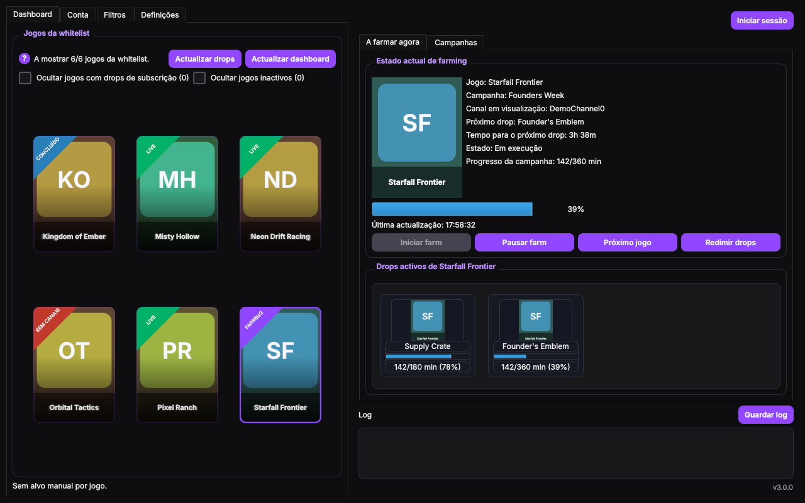

# Twitch Drop Farmer

[PT-PT](README.md) | [EN](README.en.md)

Aplicação desktop (Python + PySide6) que farma **Twitch Drops** por ti: escolhe a campanha, mantém o
tempo de visualização a contar sem abrires nenhum vídeo, recupera sozinha quando algo encrava e avisa-te
quando um drop está pronto a reivindicar. Tudo corre no teu computador.

> **Projecto independente, sem qualquer ligação à Twitch.** Automatizar a visualização pode ir contra os
> termos de serviço da plataforma e a Twitch pode mudar ou bloquear o que esta aplicação usa, sem aviso.
> Usa por tua conta e risco. Mais em [Limitações conhecidas](#limitações-conhecidas) e [Aviso](#aviso).



*As capturas de ecrã usam dados de exemplo (jogos e canais fictícios), nunca uma conta real.*

## O que faz

- **Descobre campanhas** activas e futuras. Quando a Twitch recusa o dashboard («failed integrity check»),
  usa o registo público [twitchdrops.app](https://twitchdrops.app) para saber o que existe e continua a farmar.
- **Escolhe o melhor alvo** por regras de campanha, elegibilidade e canal disponível (prioridade configurável:
  as que terminam mais cedo, etc.). Podes **fixar um jogo** a partir de um cartão do dashboard.
- **Farma sem abrir vídeo**: envia os heartbeats de visualização e vigia o fluxo do canal em segundo plano, com
  poucos pedidos e perfis de energia (Económico, Balanceado, Agressivo).
- **Recupera sozinha**: um monitor detecta campanhas que não creditam, reinicia, muda de canal e, no limite,
  desiste e põe a campanha de parte. Lembra-se das campanhas que já concluíste para não as voltar a farmar.
- **Retoma onde ficou**: lembra-se do último jogo e, se o farm estava a correr quando fechaste a app, volta a
  arrancar sozinho (desactivável).
- **Dashboard** com um cartão por jogo e uma fita de estado: `FARMING`, `LIVE`, `A VERIFICAR`, `SEM CANAIS`,
  `LIGAR CONTA`, `SUBSCRIÇÃO`, `CONCLUÍDO`, `INATIVO`. Filtros para ocultar jogos só de subscrição ou inactivos.
- **Filtros** por lista branca e lista negra de jogos e canais, com pesquisa e acções em lote.
- **Alertas** (e notificações no Windows) para drop pronto, campanha a expirar, farm sem progresso, canal
  desligado, sessão inválida e erros de ligação.
- **Sessão simples**: o botão **Iniciar sessão** explica cada passo; opcionalmente lembra a sessão neste
  computador.
- **Diagnóstico e log**: um diagnóstico do sistema, e «Guardar log» grava um ficheiro com tokens e cookies
  **removidos**, pronto a partilhar.
- Interface em **Português (Portugal)** e **English**, com vários temas.

## Como funciona

1. Lê o *Inventory* e o dashboard da Twitch com a tua sessão para saber o teu progresso real.
2. Escolhe um canal com drops activos para o jogo e envia os heartbeats de visualização, sem reproduzir vídeo.
3. Confirma no *Inventory* que os minutos estão mesmo a ser creditados. Se não estiverem, escala: reinicia a
   ligação, troca de canal, e por fim passa à campanha seguinte.

Um jogo que acabou de começar só aparece no *Inventory* depois de a Twitch creditar os primeiros minutos
(2 a 3 minutos, normalmente). Até lá, «Drops activos» diz que está **a aguardar** a informação, e só passados
15 minutos sem dados é que diz «Sem drops activos».

## Instalação

### Pacote Windows (mais simples)

Precisas de Windows 10 ou 11 de 64 bits. Não é preciso instalar o Python nem o Visual C++: vêm no pacote.

1. Vai a [Releases](../../releases) e descarrega `TwitchDropFarmer-win64.zip` (cerca de 220 MB).
2. Extrai a pasta toda (não só o `.exe`), para um sítio normal como `Documentos`, e abre `TwitchDropFarmer.exe`.

O pacote não está assinado, por isso o Windows SmartScreen pode avisar na primeira execução («Mais informações» e
«Executar mesmo assim»), e alguns antivírus podem desconfiar de programas empacotados com PyInstaller. Se o
Windows mostrar «Falta VCRUNTIME140.dll» ou parecido, extraíste só o `.exe`: extrai a pasta toda.

### A partir do código-fonte

Precisas de Python 3.10 ou mais recente (de [python.org](https://www.python.org); evita o do Anaconda).

Windows (PowerShell):

```powershell
python -m venv .venv
.\.venv\Scripts\Activate.ps1
python -m pip install -r requirements.txt
$env:PYTHONPATH="src"
python -m twitch_drop_farmer
```

Linux / macOS:

```bash
python -m venv .venv
source .venv/bin/activate
python -m pip install -r requirements.txt
PYTHONPATH=src python -m twitch_drop_farmer
```

No Windows também podes fazer duplo clique em `TwitchDropFarmer.pyw`, que abre a app sem janela de consola.
O Windows é o alvo principal; noutros sistemas deve funcionar (PySide6), mas não é testado da mesma forma.

## Primeiros passos

1. Carrega em **Iniciar sessão** (canto superior direito) e segue os passos. Se marcares «Lembrar a sessão neste
   computador», nas próximas vezes o botão entra sozinho.
2. Em **Filtros**, marca os jogos que queres farmar (se não marcares nenhum, todos os jogos activos podem ser
   farmados).
3. Em **Dashboard**, carrega num cartão para fixar um jogo, ou deixa a app escolher.
4. Carrega em **Iniciar farm**. O progresso, o canal e o tempo até ao próximo drop aparecem em «A farmar agora».
5. Quando o aviso «Drop pronto» aparecer, reivindica em
   [twitch.tv/drops/inventory](https://www.twitch.tv/drops/inventory).

### Alternativas de autenticação (aba Conta)

- **Token rápido**: cola só o valor do cookie `auth-token` do teu browser (sem o nome do cookie e sem o prefixo
  `OAuth`), guarda e valida.
- **Sessão duradoura**: exporta a sessão em JSON do browser onde tens a sessão iniciada e importa-a na aba Conta.

## Redimir drops

A opção **«Redimir drops automaticamente» vem desligada**, e há uma razão: a Twitch costuma rejeitar o
*claim* feito por esta aplicação («failed integrity check»), enquanto o mesmo clique no site ou no telemóvel
funciona. Ligá-la quase só produz tentativas falhadas (cada uma é uma rajada de pedidos que a Twitch pode ver
como automação). O mais fiável é reivindicar em [twitch.tv/drops/inventory](https://www.twitch.tv/drops/inventory)
quando a app avisar. O «?» ao lado da opção explica isto na própria aplicação. O botão **Redimir drops** faz
uma tentativa manual.

## Os teus dados e a privacidade

Tudo fica no teu computador, na pasta `~/.twitch-drop-farmer` (no Windows,
`C:\Users\<utilizador>\.twitch-drop-farmer`):

| Ficheiro | O que tem |
| --- | --- |
| `config.json` | As tuas definições e listas de jogos/canais |
| `cookies.json` | O cookie de sessão, **em texto simples** |
| `session.json` | A sessão guardada, **só se disseres que sim** em «Lembrar a sessão» (apagado ao desligar) |
| `campaign_cache.json`, `registry_rewards.json`, `completed_campaigns.json` | Caches de campanhas (sem segredos) |
| `logs/` | Os logs que gravares, com segredos removidos |

A aplicação só fala com: a Twitch (`twitch.tv` e os seus servidores de vídeo e imagens), o registo público
`twitchdrops.app` (só leitura), `api.github.com` (verificar se há versão nova) e, para obter capas de jogos
que a Twitch não fornece, DuckDuckGo, Google e Steam (apenas com o **nome do jogo**). Não há telemetria, contas
próprias nem servidores do projecto.

**Nunca partilhes** `cookies.json`, `session.json` nem um JSON de sessão: quem os tiver entra na tua conta
Twitch. Antes de abrires uma *issue*, revê o log (o «Guardar log» já remove tokens e cookies). Política de
segurança e divulgação responsável: [SECURITY.md](SECURITY.md).

## Limitações conhecidas

- A Twitch pode rejeitar pedidos desta app com «failed integrity check». É o motivo de o *claim* automático vir
  desligado e de haver jogos sem detalhe por drop durante os primeiros minutos.
- Drops que exigem **subscrição** não se farmam: aparecem com a fita `SUBSCRIÇÃO` (e podes ocultá-los).
- Um jogo novo demora uns minutos a aparecer com informação (ver [Como funciona](#como-funciona)).
- **Procurar actualizações** só avisa se há uma versão nova; não a descarrega nem instala.
- Isto depende de comportamentos da Twitch que mudam sem aviso: se algo deixar de funcionar, pode ser preciso
  actualizar as consultas GraphQL.

## Resolução de problemas

- Erro de DLL `QtCore` no Windows: cria a `.venv` com o Python oficial (python.org), não com o do Anaconda.
  Se usas Conda, instala o `PySide6` a partir do `conda-forge`. Se persistir, reinstala o Microsoft Visual C++
  Redistributable e recria a `.venv`.
- O ícone da app continua desactualizado no Windows: corre `tools\refresh_icon_cache.ps1` (ou, sem interacção,
  `powershell -ExecutionPolicy Bypass -File .\tools\refresh_icon_cache.ps1 -Force`).
- Uma campanha não credita: espera uns minutos (ver [Como funciona](#como-funciona)). Se continuar assim, o
  monitor muda de canal e, no fim, põe-na de parte. «Actualizar dashboard» faz a app tentar de novo as que
  deu por perdidas.
- Precisas de pedir ajuda: usa **Guardar log**, que cria um ficheiro com os segredos removidos, e anexa-o.

## Desenvolvimento

Testes (a interface corre sem ecrã com `QT_QPA_PLATFORM=offscreen`):

```bash
QT_QPA_PLATFORM=offscreen python -m unittest discover -s tests
```

Os testes incluem uma verificação de que nenhum ficheiro seguido pelo git tem emails, tokens, IDs de conta ou
caminhos de utilizador. Para que procure também termos teus (o teu nome de utilizador, por exemplo), põe-nos,
um por linha, em `tests/.private_terms` (ignorado pelo git).

Cada alteração incrementa a versão em `src/twitch_drop_farmer/__init__.py` e acrescenta uma entrada ao
[CHANGELOG](CHANGELOG.md); um teste falha se uma das duas faltar.

Gerar o pacote Windows (usa `onedir`, porque um só `.exe` com o Qt WebEngine ficaria enorme):

```powershell
.\build_exe.ps1
```

Cria `dist\TwitchDropFarmer\TwitchDropFarmer.exe` e `dist\TwitchDropFarmer-win64.zip`. Uma *tag* `v*` faz o GitHub
Actions construir o pacote e publicá-lo numa *release*. As capturas de ecrã deste README geram-se com
`python tools/take_screenshots.py` (dados fictícios, sem rede e sem ler a tua configuração).

```text
src/twitch_drop_farmer/
  __main__.py          arranque
  ui.py                janela principal, dashboard, filtros, definições
  twitch_client.py     pedidos à Twitch (GraphQL, Inventory, heartbeats) e ao registo público
  farmer.py            motor: escolha do alvo, campanhas e canais
  farm_health.py       monitor de bloqueios e recuperação
  stream_watcher.py    vigilância do fluxo do canal em segundo plano
  completions.py       memória das campanhas já concluídas
  registry_rewards.py  o que o registo diz que cada drop exige (tempo ou subscrição)
  login_dialog.py      janela «Iniciar sessão»
  alerts.py            alertas e notificações
  config.py            definições e caminhos dos ficheiros
  energy_profiles.py   perfis de energia
  diagnostic.py        diagnóstico do sistema
  log_export.py        gravar o log sem segredos
  updater.py           verificação de versão nova
  models.py, game_names.py
tests/                 testes automáticos
tools/                 ferramentas de apoio (capturas de ecrã, sondas, ícone)
```

## Aviso

Este projecto não é afiliado nem apoiado pela Twitch. Depende de endpoints que podem mudar ou ser bloqueados
sem aviso, e a utilização de automação pode violar os termos de serviço da Twitch e levar à restrição da conta.
É fornecido tal como está, sem garantias, e a responsabilidade pelo uso é toda tua.

## Licença

Licença MIT. Ver [LICENSE](LICENSE).
